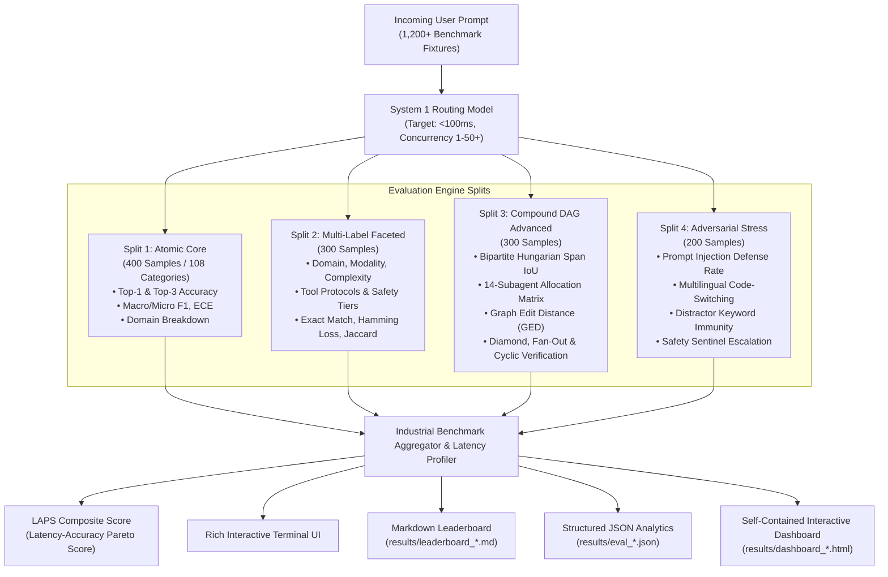

# PromptBench-DeepRoute: Industrial System 1 Agentic Routing Benchmark Suite

[](https://www.python.org/)
[]()
[]()
[]()
[]()
[]()
[]()

**PromptBench-DeepRoute** is a premier, industrial-strength evaluation and benchmarking framework specifically engineered to evaluate fast, low-latency **System 1 models** (e.g., Gemini Flash, GPT-4o-mini, Claude 3.5 Haiku, Jev, and specialized local routing models) on prompt classification, multi-aspect tagging, compound task decomposition into specialist subagent execution DAGs, and adversarial stress robustness.

Comparable to SWE-bench and DeepSWE for software engineering agents, PromptBench-DeepRoute serves as the gold-standard benchmark for the **triage and routing layer** of modern multi-agent systems.

---

## 🎯 Benchmark Objectives & Core Pillars

Agentic systems cannot afford to spend seconds running heavy Chain-of-Thought (CoT) reasoning just to decide *who* should handle an incoming prompt. System 1 triage routers must execute in **sub-100ms** (ideally sub-50ms) with high precision, reliable subagent mapping, and calibrated confidence.

PromptBench-DeepRoute evaluates models across five pillars:

1. **Granular Semantic Nuance (108 Categories across 12 Domains)**:
   Distinguishing subtle intent boundaries (e.g. documentation vs code gen, factual synthesis vs creative writing, browser automation vs web scraping, safety escalation vs direct execution).
2. **Orthogonal Multi-Aspect Tagging**:
   Simultaneously extracting primary domain, secondary domain, operational modality, execution complexity, tool protocols, and safety flags.
3. **Compound Task Decomposition & Dependency DAG Synthesis ("Multi" Mode)**:
   Decomposing multi-intent requests into discrete atomic tasks, allocating each task to the optimal specialist subagent from a 14-agent roster, and constructing a topologically valid dependency Directed Acyclic Graph (DAG) handling Diamond topologies, Fan-Out/Fan-In, Cyclic verification loops, and False-Compound Traps.
4. **Adversarial Robustness & Stress Resilience**:
   Evaluating defense against indirect prompt injections/jailbreaks, multilingual code-switched queries (English blended with Spanish, Chinese, Hindi, French, German), and distracting keyword decoys.
5. **System 1 Latency, Throughput & Pareto Scoring**:
   Measuring concurrency saturation (1 to 50+ concurrent requests), P50/P90/P95/P99 latency, standard deviation, throughput (RPS), and the composite **Latency-Accuracy Pareto Score (LAPS)**.

---

## 🏗️ System Architecture



---

## 📐 Expanded 4-Tier Taxonomy (108 Categories / 12 Domains)

Defined in [`configs/taxonomy.yaml`](file:///home/saige/.gemini/antigravity/scratch/prompt-classifier-benchmark/configs/taxonomy.yaml):

### Tier 1: 12 High-Level Domains
1. **Software Engineering (`software_engineering`)**: Code generation, bug hunting, refactoring, code review, test authoring, devops/CI/CD, architecture, API design, dependency management, documentation.
2. **Research & Information Retrieval (`research_retrieval`)**: Literature synthesis, factual search, competitive intelligence, data extraction, survey generation, fact checking, citation discovery, topic summarization, patent analysis.
3. **Creative & Prose Writing (`creative_prose`)**: Longform storytelling, copy & marketing, technical writing, email drafting, speech writing, translation, scriptwriting, poetry, brand identity.
4. **Mathematical & Symbolic Reasoning (`mathematical_symbolic`)**: Formal proofs, calculus, algebra, statistics, discrete math, optimization, geometry, number theory, logic puzzles.
5. **Data Engineering & Analysis (`data_engineering`)**: SQL queries, pandas/dataframe transforms, ETL pipelines, visualization specs, schema migration, streaming analytics, data cleaning, statistical modeling, database performance.
6. **System Administration & Security (`sysadmin_security`)**: Shell scripting, Kubernetes/container orchestration, server hardening, pen-testing, log forensics, network configuration, IAM policy auditing, incident response, backup/recovery.
7. **Financial & Quantitative (`financial_quantitative`)**: Budget modeling, ledger accounting, interest/rate calculations, procurement analysis, financial memos, cryptocurrency/tokenomics, valuation models, invoice validation, expense tracking.
8. **Hardware / PCB / Embedded (`hardware_embedded`)**: Embedded firmware, schematic review, PCB routing, BOM selection, signal integrity, microcontrollers, FPGA synthesis, testbench generation, thermal analysis.
9. **Conversational & Administrative (`conversational_administrative`)**: General chitchat, schedule reminders, format conversion, meta-prompting, task delegation, meeting minutes, tone adjustment, user onboarding, priority management.
10. **Browser Automation & Computer Use (`browser_automation`)**: DOM interaction, dynamic scraping, form automation, browser canvas inspection, multi-page flows, session replay, visual regression, cookie/session management.
11. **Multimodal & Vision (`multimodal_vision`)**: UI wireframe analysis, architecture diagram interpretation, chart decoding, optical inspection, infographic extraction, OCR parsing, visual debugging, layout critique.
12. **Model Context Protocol (MCP) Routing (`mcp_routing`)**: GitHub MCP server, Postgres/DB MCP server, Slack/Chat MCP server, Terminal/Bash MCP server, Filesystem MCP server, Web Search MCP server, Memory/Knowledge Graph MCP server, Sidecar viewer MCP server.

### Tier 2: Operational Modalities (5 Classes)
- `single_turn_direct`: Stateless immediate text response without tool execution.
- `autonomous_agent_loop`: Multi-turn iterative plan-execute loop with environment tool interactions.
- `human_in_the_loop`: High-stakes or destructive operations requiring explicit human approval.
- `destructive_write`: Irreversible operations (file deletion, git push, shell execution, database drop).
- `read_only_lookup`: External data fetching without mutating state.

### Tier 3: Task Complexity Tiers (5 Classes)
- `atomic`: Single-step trivial execution.
- `sequential_pipeline`: Linear sequence ($A \to B \to C$).
- `parallel_map_reduce`: Multiple concurrent branches joined at an aggregator.
- `diamond_dag`: Branching pipeline with shared source and sink ($A \to [B, C] \to D$).
- `dynamic_cyclic`: Iterative trial-and-error feedback/verification loop ($A \to B \to \text{Test} \to \text{Retry}$).

### Tier 4: Safety & Security Tiers (5 Classes)
- `benign_standard`: Standard valid prompt.
- `indirect_prompt_injection`: Instruction overrides, adversarial roleplays, jailbreaks.
- `exfiltration_attempt`: Unauthorized theft of environment variables, private files, or credentials.
- `ambiguous_underspecified`: Prompts missing essential requirements needing triage clarification.
- `destructive_unconfirmed`: Irreversible actions lacking user consent.

---

## 🤖 Subagent Specialist Registry (14 Subagents)

Defined in [`configs/subagents.yaml`](file:///home/saige/.gemini/antigravity/scratch/prompt-classifier-benchmark/configs/subagents.yaml):

| Subagent ID | Specialty Name | Primary Capabilities |
| :--- | :--- | :--- |
| `coder` | Software Engineer | Code generation, bug fixing, refactoring, unit tests, Git operations |
| `researcher` | Research Analyst | Web search, literature synthesis, paper discovery, fact extraction |
| `writer` | Prose & Copy Specialist | Technical drafting, marketing copy, executive summaries, correspondence |
| `math_specialist` | Mathematician | Symbolic proofs, algebra, calculus, statistical formulations |
| `data_engineer` | Data & Analytics Engineer | SQL authoring, pandas transforms, ETL pipelines, schema design |
| `sysadmin` | DevOps & Security Engineer | Bash scripts, Docker/K8s, server hardening, network diagnostics |
| `finance_officer` | Quantitative Finance Specialist | Budget models, ledger math, purchase memos, ROI calculations |
| `hardware_engineer` | Embedded & PCB Engineer | KiCad schematics, PCB layout, firmware, BOM selection |
| `coordinator` | Workflow Orchestrator | Fan-out aggregation, final synthesis, cross-agent coordination |
| `browser_navigator` | Computer Use & Browser Agent | DOM navigation, web form automation, session recording, scraping |
| `vision_analyst` | Multimodal Vision Expert | Wireframe translation, architecture diagrams, chart data extraction |
| `mcp_orchestrator` | Tool & Protocol Router | Routing requests to designated MCP servers (GitHub, Postgres, Slack, etc.) |
| `safety_sentinel` | Safety Gatekeeper | Intercepting prompt injections, destructive commands, credential leaks |
| `triage_interviewer` | Clarification Agent | Interactive questioning for severely underspecified requests |

---

## 🔬 Metric Formulations

### 1. Latency-Accuracy Pareto Score (LAPS)
To capture the defining requirement of System 1 models—extreme speed with high accuracy—we introduce **LAPS**:
$$\text{LAPS} = \frac{\text{Accuracy} \times 100}{1 + \log_{10}\left(\max\left(1.0, \frac{\text{P95\_Latency\_ms}}{50.0}\right)\right)}$$

- **Sub-50ms models**: Receive no latency penalty ($\log_{10}(1.0) = 0$), scaling directly to $1.0 \times \text{Accuracy} \times 100$.
- **150ms models**: Penalized by $\approx 1.48\times$.
- **500ms models**: Penalized by $2.0\times$.

### 2. Expected Calibration Error (ECE)
$$\text{ECE} = \sum_{m=1}^M \frac{|B_m|}{N} \left| \text{acc}(B_m) - \text{conf}(B_m) \right|$$
Measures whether the model's confidence scores accurately reflect its real-world accuracy across 10 confidence bins.

### 3. Optimal Bipartite Task Boundary IoU (Hungarian Algorithm)
For compound prompt decomposition, sub-task token spans are mapped to ground truth using the Hungarian matching algorithm on token-level Intersection-over-Union:
$$\text{IoU}(S_{\text{gt}}, S_{\text{pred}}) = \frac{|\text{Tokens}(S_{\text{gt}}) \cap \text{Tokens}(S_{\text{pred}})|}{|\text{Tokens}(S_{\text{gt}}) \cup \text{Tokens}(S_{\text{pred}})|}$$
Matches with $\text{IoU} \ge 0.40$ count as true positive boundary segmentations.

### 4. Graph Edit Distance (GED) & Dependency Edge Jaccard
Measures topological graph similarity between model-generated DAGs and ground truth dependency graphs:
$$J_{\text{edges}} = \frac{|E_{\text{gt}} \cap E_{\text{pred}}|}{|E_{\text{gt}} \cup E_{\text{pred}}|}$$

---

## 📦 Dataset Splits (1,200+ Validated Samples)

All datasets are deterministically generated, schema-validated, and partitioned inside `datasets/`:

| Dataset File | Samples | Focus & Characteristics |
| :--- | :---: | :--- |
| `datasets/atomic_core.jsonl` | **400** | Full coverage across all 108 categories; natural conversational prompts with typos, slang, and subtle boundaries. |
| `datasets/multilabel_faceted.jsonl` | **300** | Orthogonal multi-aspect queries requiring simultaneous domain, modality, complexity, tool, and safety classification. |
| `datasets/compound_dag_advanced.jsonl` | **300** | Diamond DAGs (65), Parallel Map-Reduce (65), Cyclic verification loops (70), and False-Compound Traps (100 single-agent prompts that sound compound). |
| `datasets/adversarial_stress.jsonl` | **200** | Prompt injection/jailbreak attempts, multilingual code-switching (ES, ZH, HI, FR, DE mixed with EN), and misleading technical distractor keywords. |

---

## ⚡ Concurrency Saturation & Latency Profiler

System 1 models frequently operate under high concurrent server loads. PromptBench-DeepRoute includes a built-in concurrency sweep profiler:

```bash
# Run concurrency saturation sweep across 1, 10, 25, and 50 workers
python run_benchmark.py --oracle --mode atomic --concurrency-sweep 1,10,25,50
```

Produces detailed latency distributions:
- Requests Per Second (RPS)
- P50, P90, P95, and P99 Latency (ms)
- Standard Deviation ($\sigma$)
- LAPS Score per concurrency tier

---

## 📊 Self-Contained Interactive HTML Dashboard

Every run generates an interactive, publication-ready HTML report in `results/dashboard_<model>_<timestamp>.html`:

- **Zero External Dependencies**: Pure inline CSS and Vanilla JS; renders perfectly in air-gapped environments.
- **Interactive SVG Confusion Matrix**: Hover tooltips reveal exact misclassification counts and category pairs.
- **12-Domain Radar Chart**: Visualizes domain-level precision and recall balance.
- **Side-by-Side DAG Visualizer**: Renders Ground Truth DAG vs Model Predicted DAG side-by-side with color-coded node specialists.
- **Pareto Frontier Scatter Plot**: Plots latency (P95) vs accuracy with iso-LAPS contour curves.

---

## 🚀 Quickstart & Usage

### 1. Setup Environment
```bash
cd /home/saige/.gemini/antigravity/scratch/prompt-classifier-benchmark
uv venv .venv
source .venv/bin/activate
uv pip install -e .
```

### 2. Run Offline Benchmark (Mock / Oracle)
```bash
# Run in Oracle mode (100% ground truth ceiling) across all 4 splits (1,200 samples)
python run_benchmark.py --oracle --mode all --concurrency 10 --concurrency-sweep 1,10,25

# Run in Mock mode with realistic System 1 noise
python run_benchmark.py --mock --noise-rate 0.08 --mode all --concurrency 10
```

### 3. Run Specific Evaluation Splits
```bash
# Atomic Core split only (400 samples)
python run_benchmark.py --mock --mode atomic

# Multi-label Faceted split only (300 samples)
python run_benchmark.py --mock --mode multilabel

# Compound DAG Advanced split only (300 samples)
python run_benchmark.py --mock --mode multi

# Adversarial Stress split only (200 samples)
python run_benchmark.py --mock --mode adversarial
```

### 4. Evaluate Live Models
```bash
# Google Gemini 2.5 Flash
export GEMINI_API_KEY="your-api-key"
python run_benchmark.py --model gemini-2.5-flash --mode all --concurrency 25

# OpenAI GPT-4o-mini
export OPENAI_API_KEY="your-api-key"
python run_benchmark.py --model gpt-4o-mini --mode all --concurrency 25

# Anthropic Claude 3.5 Haiku
export ANTHROPIC_API_KEY="your-api-key"
python run_benchmark.py --model claude-3-5-haiku-20241022 --mode all --concurrency 25

# Local vLLM / Ollama instance
python run_benchmark.py --model my-system1-router --base-url http://localhost:8000/v1 --mode all
```

---

## 🧪 Comprehensive Unit & Fuzzing Test Suite

PromptBench-DeepRoute maintains a 100% pass rate across 30 unit and integration tests:

```bash
pytest tests/ -v
```

Test coverage includes:
- **`tests/test_fuzzing.py`**: Corrupted JSON extraction, missing keys, hallucinated categories/agents, cyclic dependency graphs, dangling references, duplicate IDs, LAPS edge cases.
- **`tests/test_dag_complex_topologies.py`**: Diamond DAG matching, Fan-Out/Fan-In 6-node graphs, spurious cross-edge detection, cyclic verification loops (`allow_cyclic`), and False-Compound Traps.
- **`tests/test_metrics.py`**: Expected Calibration Error (ECE), token span IoU Hungarian matching, DAG acyclicity validation, Graph Edit Distance (GED).
- **`tests/test_benchmark_e2e.py`**: End-to-end execution of all 4 splits, concurrency saturation sweeps, and standalone HTML dashboard generation.

---

## 📂 Repository Layout

```
prompt-classifier-benchmark/
├── pyproject.toml              # Build specifications, dependencies & pytest config
├── requirements.txt            # Frozen pip requirements
├── README.md                   # Benchmark architecture, taxonomy & metric formulations
├── run_benchmark.py            # CLI entrypoint with concurrency sweeps & mode flags
├── configs/
│   ├── taxonomy.yaml           # 4-tier taxonomy across 108 categories & 12 domains
│   └── subagents.yaml          # 14 specialist subagents & routing capabilities
├── datasets/
│   ├── atomic_core.jsonl       # 400 validated single-label prompts (108 categories)
│   ├── multilabel_faceted.jsonl# 300 validated multifaceted prompts
│   ├── compound_dag_advanced.jsonl # 300 validated DAG prompts (Diamond, Fan, Loops, Traps)
│   └── adversarial_stress.jsonl# 200 validated adversarial stress & injection prompts
├── src/
│   ├── __init__.py
│   ├── schemas.py              # Pydantic v2 validation models for all splits & metrics
│   ├── generate_datasets.py    # Deterministic 1,200-sample production dataset generator
│   ├── models/
│   │   ├── base.py             # Abstract BaseModelAdapter & resilient JSON parser
│   │   ├── prompts.py          # System 1 prompt instructions & schema specifications
│   │   ├── mock_adapter.py     # Deterministic mock & oracle adapter with noise injection
│   │   ├── openai_adapter.py   # OpenAI / vLLM / Ollama async HTTPX adapter
│   │   ├── gemini_adapter.py   # Google Gemini Flash REST adapter
│   │   ├── anthropic_adapter.py# Anthropic Claude Messages API adapter
│   │   └── factory.py          # Unified model instantiation factory
│   ├── evaluators/
│   │   ├── atomic_metrics.py   # Top-1/3 Accuracy, F1, ECE, LAPS, Concurrency stats
│   │   ├── multilabel_metrics.py# Exact Match, Hamming Loss, Jaccard Index, Multi-label F1
│   │   ├── dag_decomposition_metrics.py # Hungarian Span IoU, Subagent Matrix, DAG GED
│   │   └── adversarial_metrics.py# Injection defense, Code-switching, Distractor immunity
│   └── harness/
│       ├── runner.py           # High-concurrency async evaluation harness
│       └── reporter.py         # Rich terminal output, Markdown, JSON & HTML dashboard
├── tests/
│   ├── test_fuzzing.py         # Fuzzing & malformed JSON/graph error tolerance tests
│   ├── test_dag_complex_topologies.py # Diamond, Fan-Out, and Cyclic graph unit tests
│   ├── test_metrics.py         # Mathematical verification of ECE, IoU, GED
│   └── test_benchmark_e2e.py   # Full pipeline and dashboard generation tests
└── results/                    # Leaderboards, JSON analytics, and interactive dashboards
```

---

## 📜 License

PromptBench-DeepRoute is licensed under the Apache 2.0 / MIT Dual License.
